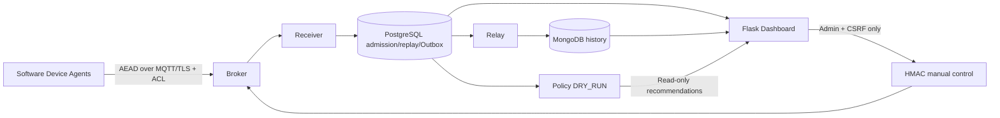

# LightCrypto Manager

Исследовательский прототип защищённой IoT-системы с **ручным криптографическим управлением** и экспериментальной оценкой сетевых аномалий. Финальный демонстрационный контур — Stage16; итоговый verdict и доказательства находятся в [отчёте](docs/STAGE16_RESULTS.md).



Основной demo: **Ascon-AEAD128 и AES-128-GCM**, три настоящих software Device Agents Alpha/Beta/Gamma, MQTT/TLS, PostgreSQL, Outbox, MongoDB, Dashboard, durable PREPARE/ACTIVATE/ACK и подтверждение effective только новой принятой AEAD-телеметрией. Gamma — Ascon-only. Это не физические IoT-устройства.

**Kuznyechik-MGM реализован, но остаётся lab-only** в существующих явно разрешённых Stage11/12/13 контурах. Magma не допускается к текущей continuous telemetry. RF/IF — research-only, `trusted_detector=false`; Policy — `DRY_RUN`. Автоматического ML/Policy/Shadow→crypto control нет. Shadow IDS необязателен: в основном Stage16 demo **OPTIONAL_RESEARCH_DEMO_UNAVAILABLE**, его отдельные capture/parity/model scopes не provisioned. Отсутствие приватных моделей не блокирует основной продукт и не заменяется fake scores.

## Быстрый запуск на новом checkout

Linux x86_64, Python3.12, Docker/Compose, OpenSSL; доступ к pinned packages/images при первой сборке. Рекомендуется около4GiB доступной RAM и несколько GiB диска. Все команды из корня репозитория:

```bash
python3 -m venv .venv
.venv/bin/python -m pip install -r requirements/receiver.txt -r requirements/publisher.txt -r src/web/requirements.txt -r requirements/dev.txt
.venv/bin/python -m scripts.stage16_demo preflight
.venv/bin/python -m scripts.stage16_demo prepare
.venv/bin/python -m scripts.stage16_demo start --build
.venv/bin/python -m scripts.stage16_demo status
.venv/bin/python -m scripts.stage16_demo smoke --output .local-runtime/stage16/demo-smoke-01.json
```

Dashboard: **http://127.0.0.1:15016** по умолчанию; runner печатает фактический loopback URL. Учётные записи `demo-admin`, `demo-operator`, `demo-viewer`; пароли только в private `.local-runtime/stage16/demo/accounts/<role>.password` (0600). Admin переключает профиль, Operator/Viewer читают. Не публикуйте private файлы.

## Сохранение и продолжение

```bash
.venv/bin/python -m scripts.stage16_demo evidence --output .local-runtime/stage16/demo-evidence-01.json
.venv/bin/python -m scripts.stage16_demo stop
.venv/bin/python -m scripts.stage16_demo resume
```

На текущем workspace demo уже подготовлен: используйте **resume**, не повторный prepare. Stop сохраняет keys/volumes/SQLite/replay/commands/receipts. Resume не выполняет provisioning заново и отказывает при потерянном/заменённом used state. Новому независимому demo нужны новый root/project, свободная explicit subnet и порты; [полные команды](docs/STAGE16_DEMO_RUNBOOK.md). Старые сети/volumes не удалять, down-v/prune/reset не использовать.

## Что можно показать и описать

- [Демонстрация на5–10минут](docs/STAGE16_DEMO_SCRIPT.md), после подготовки images.
- [Архитектура и7 исходных схем](docs/STAGE16_FINAL_ARCHITECTURE.md).
- [Реальная E2E matrix](docs/STAGE16_E2E_TEST_MATRIX.md), [каталог доказательств](docs/reports/stage16/evidence-catalog.json).
- [Безопасность и восстановление](docs/STAGE16_SECURITY_AND_RECOVERY.md), [ограничения A/B/C](docs/STAGE16_KNOWN_LIMITATIONS.md).
- [Итоговые результаты](docs/STAGE16_RESULTS.md), [реальные screenshots](docs/reports/stage16/browser-final.json).

Последняя полная регрессия: **1057 passed, 0 skipped, exit0** на изолированных настоящих PG/Mongo. Main/push/merge не изменялись в ходе Stage16. Сырые PCAP, модели, ключи и state остаются приватными.

Нет production-ready IDS, ARM/Raspberry Pi проверки, HA или криптографической сертификации. Stage14 RF recall≈49%, IF≈7.7%, всего5 positive holdout sessions; Stage15 IF дал254/375 false threshold crossings на corroborated Normal subset. Нет independent-host generalization, scores не probabilities атаки. Пороги/модели/старый holdout не менялись. [Подробные научные границы](docs/STAGE16_POLICY_AND_ML_LIMITATIONS.md).

## История проекта

Ниже сохранён предыдущий README как исторический снимок; актуальные запуск и ограничения описаны выше.

<details><summary>Описание на момент завершения Stage15 и предыдущих этапов</summary>

# LightCrypto Manager

Дипломная система защищённой IoT telemetry и ручного адаптивного управления базовыми
AEAD: **Ascon-AEAD128** и **AES-128-GCM**. MQTT/TLS + ACL, PostgreSQL authoritative
admission/replay/Outbox, MongoDB history, Flask dashboard, durable HMAC control,
настоящие software Device Agents и подтверждение effective новой AEAD telemetry.

**Policy DRY_RUN. RF/IF RESEARCH/DEMO, trusted_detector=false.** Нет доверенного live
network IDS и автоматического выбора алгоритма по ML. Профили не ранжируются по
условной «силе»; physical Raspberry Pi/production deployment ещё не проверены.

## Текущее состояние — этап 15

[Пассивный Shadow IDS](docs/STAGE15_RESULTS.md): настоящий MQTT/TLS capture, 975-packet offline/online parity, замороженные RF/IF, отдельный durable journal и read-only `/research/shadow-ids`. Режим **RESEARCH / SHADOW_ONLY**, все sessions unbound, без подключения к Policy/Control. Полная регрессия **1049 passed, 0 skipped**; 31 поведенческая мутация, реальные crash/outage/OOM и Chromium проверки.

48 коротких runs на 3/10/25/50 software identities: 24 483 PG/Mongo admissions, 68 751 TCP packets, drops=0 в успешной серии. Это не тест максимальной вместимости. Независимая переносимость моделей **не подтверждена**; на новых corroborated Normal observations IF дал 254/375 false threshold crossings. Пороги не менялись, модели не переобучались. Сырые PCAP, модели и ключи приватные.

Stage14 offline-исследование и прежний holdout сохранены: [отчёт](docs/STAGE14_RESULTS.md). Stage13 исправил прежнее Policy backlog: [отчёт](docs/STAGE13_RESULTS.md). Policy DRY_RUN, trusted_detector=false, manual-only crypto control. Kuznyechik-MGM остаётся software lab-only; Magma не активирована. [Воспроизведение на новом изолированном стенде](docs/STAGE15_RESULTS.md#воспроизведение-и-следующий-этап).

## Исторические измерения — этап 10

Изолированные software-стенды 3/10/25/50 устройств, реальные MQTT/TLS/PG/Mongo
измерения и recovery: [результаты](docs/STAGE10_RESULTS.md),
[запуск и методика](docs/STAGE10_LOAD_TEST_PLAN.md),
[узкие места](docs/STAGE10_BOTTLENECK_ANALYSIS.md).
На 50 устройствах проверен telemetry path около 99,38 сообщения/с за 5 минут;
это не максимальная вместимость: Policy при 25×2 Гц уже отстаёт.
Итоговая регрессия — 739 passed, 0 skipped; это не доказательство качества IDS.

[Проект интеграции ГОСТ](docs/RUSSIAN_CRYPTO_INTEGRATION_DESIGN.md) и
[план сравнения реализаций](docs/CRYPTO_PROFILE_COMPARATIVE_EXPERIMENT_PLAN.md)
подготовлены для этапа 11. Кузнечик/Магма не включены в рабочие профили.

## Локальная демонстрация

```bash
uv sync --frozen --group dev
.venv/bin/python -m scripts.prepare_stage9_demo \
  --directory /tmp/lcm-stage9-demo-example --project lcm-stage9-demo-example
.venv/bin/python -m scripts.run_stage9_demo \
  --directory /tmp/lcm-stage9-demo-example start --build
```

Нужны Docker Compose, Python 3.12–3.14, uv и OpenSSL. Runner выводит loopback URL.
Три случайных account passwords остаются в приватном `accounts/*.password` (0600),
не в README/images/logs. Имена: demo-admin/demo-operator/demo-viewer. В браузере:
мониторинг → alpha → target → явное подтверждение → настоящие PREPARE/ACTIVATE/ACK
→ новая telemetry → EFFECTIVE_CONFIRMED. Beta/gamma независимы, gamma Ascon-only.

```bash
.venv/bin/python -m scripts.run_stage9_demo --directory /tmp/lcm-stage9-demo-example stop
.venv/bin/python -m scripts.run_stage9_demo --directory /tmp/lcm-stage9-demo-example start
```

Stop/resume сохраняют nonce/command authority и keys. Не удалять SQLite/SQL volumes,
не использовать `down -v` и не переинициализировать старую identity. Для нового
независимого стенда выбрать новый suffix и новые keys.

[Полная инструкция запуска и защиты](docs/STAGE9_DEMO_RUNBOOK.md) ·
[Руководство пользователя](docs/STAGE9_USER_GUIDE.md) ·
[Архитектура](docs/STAGE9_SYSTEM_ARCHITECTURE.md) ·
[Фактические результаты](docs/STAGE9_RESULTS.md) ·
[Матрица E2E](docs/STAGE9_E2E_TEST_MATRIX.md) ·
[Recovery](docs/CONTROL_RECOVERY.md) · [Security](docs/SECURITY.md).

Исторические исследования, PCAP, модели/frozen plans и отчёты прежних этапов
сохраняются. Число прошедших тестов — не доказательство качества IDS.

## Этап11: Kuznyechik-MGM в изолированном software lab

Добавлен настоящий третий AEAD: pinned Go Kuznyechik/MGM, RFC7801/RFC9058 KAT, independent cross-check, per-key budget и подтверждение переключения по PostgreSQL AEAD receipts. Обычные deployments сохраняют Ascon/AES live eligibility; MGM требует отдельной явной test-lab authorization и provisioned ключей/capabilities. Timing resistance/ARM/сертификация не заявляются. Policy остаётся DRY_RUN, RF/IF untrusted.

Запуск и остановка, приватные аккаунты и сохранение state: [STAGE11_RESULTS](docs/STAGE11_RESULTS.md). Подробности: [provider](docs/STAGE11_PROVIDER_SELECTION.md), [nonce/budget](docs/KUZNYECHIK_NONCE_AND_KEY_BUDGET.md), [verification matrix](docs/STAGE11_INTEGRATION_TESTS.md).

## Этап 12: сравнение реализаций и ограниченный Kuznyechik worker

Для лаборатории добавлен bounded local Go worker без сетевого порта; профиль и wire protocol не зависят от backend. Default — one-shot, выбор worker явный (`LCM_KUZ_BACKEND=persistent`), без fallback. Итоговая регрессия: **882 passed, 0 skipped**. Это не доказательство constant-time или качества IDS.

Magma-MGM исследована по RFC и публичным векторам, но **не допускается к continuous telemetry/live control**: короткий budget 64-битного блока несовместим с текущим lease и отсутствующим rekey lifecycle. В UI остаются три прежних профиля. Kuznyechik сохраняет lab-only; side-channel зависимость MGM не объявлена устранённой. Policy DRY_RUN, ML untrusted.

[Результаты, ограничения и графики](docs/STAGE12_RESULTS.md) · [Запуск/stop/resume](docs/STAGE12_SYSTEM_INTEGRATION.md) · [Команды и отчёты](docs/reports/stage12/COMMANDS.md) · [Magma budget](docs/MAGMA_MGM_SECURITY_BUDGET.md). Все Stage12 контейнеры после экспериментов остановлены, ключи и volumes сохранены.

## Этап13: Policy throughput и порядок событий

Indexed durable pending queue и bounded atomic batches сохраняют FSM, late events, version isolation, идемпотентность и DRY_RUN. Readiness worker теперь отделена от свежести evidence/очереди. На software-стенде проверены3/10/25/50 устройств, три независимых25-device repeats и15-минутная стабильность; подробные ограничения и фактические числа: [STAGE13_RESULTS](docs/STAGE13_RESULTS.md). [Воспроизведение/stop/resume](docs/STAGE13_POLICY_THROUGHPUT_DESIGN.md), [ordering](docs/STAGE13_EVENT_ORDERING_CONTRACT.md), [SQL](docs/STAGE13_SQL_OPTIMIZATION.md). ML остаётся untrusted, управление криптографией manual-only; новых алгоритмов нет.

</details>
