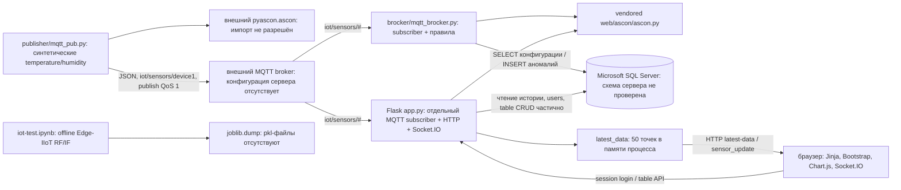

# Текущая архитектура

Дата: 2026-11-08. Схема получена из исходников; соединения сервисов не проверены
запуском. Это существующая структура после минимального удаления секретов.

`brocker` не принимает серверные MQTT-соединения, не реализует broker и не запускает
Mosquitto. Flask и receiver — независимые подписчики; Flask не получает от receiver
расшифрованные события или сигналы аномалий. ML с ними не связан.

## Реальный поток данных

1. Publisher генерирует два числа и timestamp, сериализует JSON в UTF-8.
2. AAD — отдельный JSON: строковый device_id и второй timestamp; nonce 16 случайных
   байт. Encrypt возвращает ciphertext с 16-байтовым тегом.
3. Публикуется JSON-оболочка из четырёх полей: nonce, associated_data, ciphertext
   в base64 и algorithm строкой. Внешний broker маршрутизирует сообщения.
4. Receiver читает метаданные до проверки тега, вычисляет задержку с поправкой
   +3 часа, дешифрует, применяет правила и записывает только аномалии в MSSQL.
5. Web самостоятельно дешифрует пакет, теряет device_id из AAD и обновляет общий
   буфер всех датчиков. Сохранение телеметрии отключено. Socket.IO рассылает
   температуру/влажность/время без разделения по устройствам и без connect auth.
6. Браузер сначала запрашивает историю через `/api/latest-data`, затем слушает
   sensor_update. При пустом буфере web пытается читать Log_Journal JOIN Sensor_Data.
   Источник наполнения этих таблиц рабочим кодом текущей цепочки не установлен.

Транспорт настроен на TCP/1883. Publisher/receiver не настраивают TLS и auth;
web умеет username_pw_set, но username пуст и TLS-флаг не используется при создании
клиента. QoS подписки по умолчанию 0. Подтверждения доставки/персистентность брокера
и end-to-end семантика не проверены. Повторная доставка обрабатывается как новое
событие; authenticated timestamp не используется как anti-replay.

## Хранение и жизненный цикл

Flask-SQLAlchemy настроен на MSSQL (исходный dialect `mssql+pymssql`); receiver
использует прямой pymssql с отдельными реквизитами. Таблицы/PK перечислены в
[INVENTORY.md](INVENTORY.md). В ORM нет внешних ключей; реальная серверная схема
не предоставлена. Отдельная таблица Users обслуживает web, 13 таблиц доступны
через ролевую карту. Не все предполагаемые операции реализованы.

При прямом запуске app.py выполняются `db.create_all()`, создание трёх начальных
пользователей, MQTT connect, Socket.IO dev server с debug=True на всех интерфейсах.
В импорте создаются Flask, SQLAlchemy, Socket.IO и FileHandler в `/var/log`,
но запуск MQTT находится только в main. Publisher и receiver соединяются с сетью
уже при импорте, что затрудняет изолированные проверки.

Начальная безопасная конфигурация требует окружение, указанное в BASELINE.md.
Единого конфигурационного модуля для трёх процессов нет. Нет launcher, lockfile,
контейнеров, миграций, CI и автоматического тестового набора. Схема процесса
развёртывания и эксплуатационные гарантии не определены.

Notebook работает отдельно в Kaggle-подобном окружении. Набор сетевых flow-признаков
не совпадает с decrypted JSON датчиков. Модели сохраняются без preprocessing/schema;
обратной связи от ML к криптографической части не реализовано.

FastAPI, PostgreSQL, отдельный worker как оформленный сервис, Policy Engine,
профили «Магмы»/CRISP, защищённые команды и anti-replay в этой архитектуре отсутствуют.
Их целевой план приведён отдельно в DEVELOPMENT_STATUS.md.
