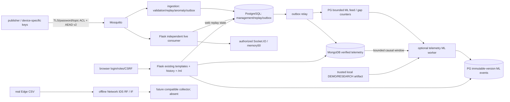

# Текущая архитектура после этапа 10

Рабочий контур этапа 9 сохранён: два AEAD, MQTT/TLS/ACL, PG admission/replay/
Outbox, Mongo history, Flask и durable manual control с telemetry receipts.
Новых SQL migrations, профилей, provider dispatch или Policy FSM не добавлено.

Изменения: opt-in bounded исследовательский журнал software agent (по умолчанию
выключен), отдельный `lcm-stage10-performance-*` adapter с независимыми volumes/
keys, ограниченные SQL/HTTP/resource probes. Журнал наблюдений не является nonce
или command authority. Ошибка БД при загрузке identity даёт HTTP503. Monitoring
разделяет свежесть Policy heartbeat и last_event_at по TTL правил; это read-only
оценка, не изменение решения FSM. Policy logs ограничены resource overlay.

Измерения и узкие места: [STAGE10_RESULTS.md](STAGE10_RESULTS.md).
Будущий provider/usage/nonce контракт: [RUSSIAN_CRYPTO_INTEGRATION_DESIGN.md](RUSSIAN_CRYPTO_INTEGRATION_DESIGN.md).
Draft ГОСТ-профили отсутствуют в live registry/UI; research ML не авторизует команды.
Ниже сохранено историческое описание.

# Текущая интеграция: Stage 9

Flask `/` объединяет inventory, PG-accepted telemetry, Mongo history, security
observations, Policy DRY_RUN и существующий manual control. Новые read-only shapes
`/api/monitoring` и `/api/monitoring/<device>` не являются control authority.
Effective берётся из существующего PG state + matching durable receipt, не ACK.

Миграция 0009 добавляет только receiver diagnostic heartbeat. Остальные authority
и протоколы неизменны. Source/status/freshness mapping, API bounds и flow diagram:
STAGE9_SYSTEM_ARCHITECTURE.md. Демонстрация: STAGE9_DEMO_RUNBOOK.md.
RF/IF RESEARCH/DEMO, trusted_detector=false; Policy не создаёт live commands.
Историческое описание ниже сохранено.

# Текущая архитектура — дополнение этапа 8

Два telemetry AEAD: Ascon-AEAD128 и AES-128-GCM, telemetry v2 сохранён.
Отдельные opt-in control-worker и Python device agent выполняют manual admin
PREPARE/ACTIVATE по MQTT/TLS+HMAC. Device ACK и telemetry-confirmed effective
разделены. PostgreSQL теперь42таблицы (0007/0008 additive); live_control_evidence
хранит минимальный authenticated receipt отдельно от Mongo sensor history и
retained telemetry outbox. Новый Crypto UI /control, RBAC/CSRF сохранены.

Policy остаётся DRY_RUN, RESEARCH/DEMO models untrusted; автоматически commands
не исполняются. Схема потока/границы: ADAPTIVE_CRYPTO_ARCHITECTURE.md,
STAGE8_RESULTS.md. Ниже историческая архитектура этапов5–7; её Ascon-only/
нет-live-channel/число34таблицы больше не описывают opt-in слой этапа8.

# Текущая архитектура — этап 7

Сохранён MQTT TLS/ACL → Ascon telemetry v2 → PG replay/anomalies/outbox → Mongo.
Optional ML по-прежнему независим. Добавлен отдельный PG-only policy-worker в
DRY_RUN: security_observations + ML events → нормализованные сигналы → FSM →
транзакционные состояния/решения/переходы/намерения → Flask /policy.

В PostgreSQL34 таблицы (0005_policy +0006_policy_control добавили11 к23).
Идентичности сигналов и решений дедуплицированы по policy version. Независимый
control counter не меняет telemetry replay-state. Source journal ограничен100000;
переполнение явно увеличивает overflow, primary ingestion продолжает работу.
Policy Worker не получает MQTT/Mongo credentials и не запускает модели.

Ascon-AEAD128 остаётся единственным реализованным профилем. Configured profile,
recommended, requested и applied разделены; applied=NULL, effective=unconfirmed.
Live control channel отсутствует. Ни SIMULATION, ни отправка сообщения не являются
подтверждённым изменением устройства. Каталог профилей независим от legacy ORM.

Актуальные документы: POLICY_ARCHITECTURE.md, POLICY_RULES.md, POLICY_STATES.md,
CONTROL_PROTOCOL_DESIGN.md, POLICY_EVALUATION.md. Ниже историческая основа этапа6.

---

# Текущая архитектура — после этапа 6

Основа cfda660 этапа5 сохранена: TLS/ACL/Ascon-v2/anti-replay, PostgreSQL+MongoDB,
Outbox, Flask/Socket.IO. Добавлены отдельные offline ML эксперименты и opt-in
асинхронный telemetry inference. Подробности — ML_ARCHITECTURE.md и ML_INFERENCE.md.

PostgreSQL23 таблицы:14 legacy, replay/outbox/ingestion_metrics/devices/Alembic,
4 ML tables. Миграция0004 сохраняет старые данные/PK/replay. Sensor_Data не удалена;
телеметрия хранится MongoDB, ML evaluations отдельно PG. Ключи по-прежнему только
в scoped private registry, не в ML features/events. MQTT сообщения не менялись.

Ingestion не импортирует sklearn и не ждёт ML. Relay только дополняет delivery ACK
bounded marker/gap transaction, не вызывает модель. Worker вне callback и HTTP,
читаeт target и не болееN предыдущих sequences device/epoch, проверяет даты;
фильтры/лимиты и claim lease не держат PG transaction при Mongo IO. Event identity:
device/epoch/sequence/model_id/version. Недоступный model не останавливает pipeline.

Прежние crypto rejects, rule anomalies и новые ML events различимы. ML score —
нетипичность по отдельной шкале, не подтверждение атаки. Minimum protection не
переключается. Network IDS остаётся offline, сенсоры не выдают Edge features.

Инженерные проверки233 pytest + Docker outages/restarts/multi-device/web/security.
На реальной ограниченной Edge подвыборке RF слаб; source/schema/разбиения и метрики
в ML_EVALUATION.md. Telemetry модели обучены только на явно synthetic DEMO данных;
real physical quality не проверена. Ни научное качество, ни1000msg/s не выводятся
из успешных integration tests. Никаких FastAPI/Policy Engine/«Магмы»/CRISP.

Ограничения: model-local trust, finite ML feed с явными gaps/retention, incomplete
pre-cutover history, source-clock quality, one Flask process/live50, shared PG
runtime role, Mongo standalone/internal DB TLS отсутствует, production HTTPS/ARM64
и массовые нагрузки не проверены. Полнота исторического ML не обещается.

## Stage11 extension

Crypto dispatch содержит три явных provider без else-fallback. Kuznyechik/MGM — pinned local Go executable через private bounded pipes; не сетевой crypto service. Fresh private provisioning добавляет32B key только alpha/beta, gamma Ascon-only. Receiver проверяет usage allowance до tag, затем существующий atomic replay/Outbox/effective transaction. PostgreSQL migration0010 хранит только metadata/counters, не ключи. Mongo validator расширяется explicit collMod. UI переиспользует monitoring/control/history APIs и показывает только supported/eligible targets; web не получает новый MGM/control key. [Provider boundary](CRYPTO_PROVIDER_ARCHITECTURE.md).

## Stage12: implementation backend boundary

Single `kuznyechik-mgm-v1` profile now has exact one-shot/persistent dispatch. Default remains one-shot. Opt-in bounded Go worker uses private framed pipes, request identity, serialization, time/frame/request/lifetime limits and no key cache. It owns no nonce, command or PG usage state. Failure is ProviderUnavailable, not invalid telemetry or automatic fallback. Crypto arithmetic, telemetry/control v2,0010 migration, Outbox and receipt authority remain unchanged.

Registry separates algorithm/implementation/lab/production eligibility. The web implementation note describes the web process configuration, not authenticated sender backend. No Python or Magma research provider is live registered. [Design and real network evidence](STAGE12_SYSTEM_INTEGRATION.md), [results](STAGE12_RESULTS.md).

## Stage13 Policy processing

Atomic source triggers→indexed `policy_pending` snapshots→bounded serialized batch→existing versioned signal/FSM/decision/DRY_RUN proposal transaction. Late inserts remain discoverable independently of timestamp; active-version replay is seeded at installation. Rules/engine semantics unchanged. Persistent fair scheduling between security and research ML; synthetic stale is per-device pending aware. Heartbeat readiness, queue lag and authenticated evidence freshness are separate read-model fields. [Ordering](STAGE13_EVENT_ORDERING_CONTRACT.md), [design](STAGE13_POLICY_THROUGHPUT_DESIGN.md), [version contract](STAGE13_VERSION_ACTIVATION_SEMANTICS.md).
