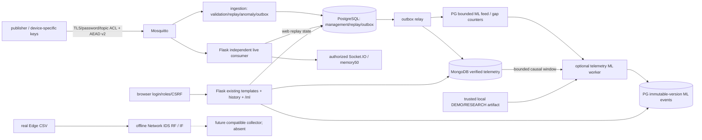

# Текущая архитектура — этап 7

Сохранён MQTT TLS/ACL → Ascon telemetry v2 → PG replay/anomalies/outbox → Mongo.
Optional ML по-прежнему независим. Добавлен отдельный PG-only policy-worker в
DRY_RUN: security_observations + ML events → нормализованные сигналы → FSM →
транзакционные состояния/решения/переходы/намерения → Flask /policy.

В PostgreSQL34 таблицы (0005_policy +0006_policy_control добавили11 к23).
Идентичности сигналов и решений дедуплицированы по policy version. Независимый
control counter не меняет telemetry replay-state. Source journal ограничен100000;
переполнение явно увеличивает overflow, primary ingestion продолжает работу.
Policy Worker не получает MQTT/Mongo credentials и не запускает модели.

Ascon-AEAD128 остаётся единственным реализованным профилем. Configured profile,
recommended, requested и applied разделены; applied=NULL, effective=unconfirmed.
Live control channel отсутствует. Ни SIMULATION, ни отправка сообщения не являются
подтверждённым изменением устройства. Каталог профилей независим от legacy ORM.

Актуальные документы: POLICY_ARCHITECTURE.md, POLICY_RULES.md, POLICY_STATES.md,
CONTROL_PROTOCOL_DESIGN.md, POLICY_EVALUATION.md. Ниже историческая основа этапа6.

---

# Текущая архитектура — после этапа 6

Основа cfda660 этапа5 сохранена: TLS/ACL/Ascon-v2/anti-replay, PostgreSQL+MongoDB,
Outbox, Flask/Socket.IO. Добавлены отдельные offline ML эксперименты и opt-in
асинхронный telemetry inference. Подробности — ML_ARCHITECTURE.md и ML_INFERENCE.md.

PostgreSQL23 таблицы:14 legacy, replay/outbox/ingestion_metrics/devices/Alembic,
4 ML tables. Миграция0004 сохраняет старые данные/PK/replay. Sensor_Data не удалена;
телеметрия хранится MongoDB, ML evaluations отдельно PG. Ключи по-прежнему только
в scoped private registry, не в ML features/events. MQTT сообщения не менялись.

Ingestion не импортирует sklearn и не ждёт ML. Relay только дополняет delivery ACK
bounded marker/gap transaction, не вызывает модель. Worker вне callback и HTTP,
читаeт target и не болееN предыдущих sequences device/epoch, проверяет даты;
фильтры/лимиты и claim lease не держат PG transaction при Mongo IO. Event identity:
device/epoch/sequence/model_id/version. Недоступный model не останавливает pipeline.

Прежние crypto rejects, rule anomalies и новые ML events различимы. ML score —
нетипичность по отдельной шкале, не подтверждение атаки. Minimum protection не
переключается. Network IDS остаётся offline, сенсоры не выдают Edge features.

Инженерные проверки233 pytest + Docker outages/restarts/multi-device/web/security.
На реальной ограниченной Edge подвыборке RF слаб; source/schema/разбиения и метрики
в ML_EVALUATION.md. Telemetry модели обучены только на явно synthetic DEMO данных;
real physical quality не проверена. Ни научное качество, ни1000msg/s не выводятся
из успешных integration tests. Никаких FastAPI/Policy Engine/«Магмы»/CRISP.

Ограничения: model-local trust, finite ML feed с явными gaps/retention, incomplete
pre-cutover history, source-clock quality, one Flask process/live50, shared PG
runtime role, Mongo standalone/internal DB TLS отсутствует, production HTTPS/ARM64
и массовые нагрузки не проверены. Полнота исторического ML не обещается.
