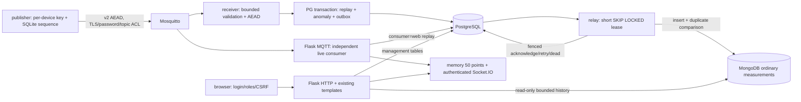

# Текущая архитектура — этап 5

Ветка feature/mongodb-telemetry-storage от d9a000f. Существующие Flask, шаблоны,
Ascon, TLS/ACL и MQTT v2 сохранены. Подробнее: DATABASE_ARCHITECTURE.md, OUTBOX.md,
TELEMETRY_SCHEMA.md, SECURITY.md, COMPOSE.md. Доказательства — reports/stage5-*.txt.

PostgreSQL: 14 неизменённых legacy таблиц, mqtt_replay_state, telemetry_outbox,
ingestion_metrics, telemetry_devices и alembic_version. Sensor_Data и её данные не удаляются, но
новый pipeline не дублирует туда телеметрию. Alembic валидирует существующую
схему перед baseline; создаёт пустую БД и новые таблицы аддитивно. Не вводит FK
и не меняет составные PK автоматически. Несекретный реестр device/topic/profile/epoch/enabled находится в telemetry_devices;
ключи остаются в ограниченных приватных файлах. PG и файлы согласуются явным
provisioning, конфликт или disabled блокирует admission и live consumer.

MongoDB — только проверенные измерения с UTC датами. Outbox сохраняет намерение
доставки до MongoDB даже при недоступности последней. Lease не держит PG
транзакцию во время сетевой записи; несколько relay безопасно конкурируют.
Unique ключ + проверка содержимого обеспечивают идемпотентность повторной записи,
но не end-to-end exactly-once. Ошибочные/исчерпавшие попытки события видимы как dead.

Receiver подтверждает QoS1 после PG commit. Backpressure ограничивает durable
backlog; очереди брокера/диск конечны. Метрики admin API: входящие/сек, accepted,
rejected, replay, retry/error/delivered, глубина/возраст outbox, средняя задержка,
количество Mongo документов. Socket.IO по-прежнему один Flask-процесс с памятью;
live событие может предшествовать Mongo доставке, быть потеряно при crash web.

MongoDB и PostgreSQL не публикуют порты наружу. MQTT и HTTP — loopback. Раздельные
Mongo roles: relay insert/find, web find. Security/storage-init кратковременно
root копируют локальные материалы в scoped volumes; runtime UID10001. CA private
key не попадает в контейнеры. Mongo использует auth во внутренней Compose network;
межсервисный MongoDB TLS и production HA ещё не настроены.

Нет ML inference, Policy Engine, FastAPI, «Магмы»/CRISP. Цели до 1000 msg/s —
будущие эксперименты, не подтверждённая производительность. Локальная проверка
не заменяет ARM64 execution, внешний security audit или production deployment.
