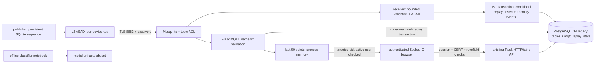

# Текущая архитектура — после этапа 4

2026-11-08. База этапа 3 — 5be5444. Реальный Compose MQTT/PG обмен, отрицательные
TLS/ACL проверки, replay после пересоздания receiver и HTTP/Socket.IO проверены.
Команды — [COMPOSE.md](COMPOSE.md), формат — [MQTT_PROTOCOL.md](MQTT_PROTOCOL.md).

## Startup / credentials

security-init копирует локально сгенерированные CA/certificate/пароли/ключи в
отдельные volumes ролей, не images. CA private key остаётся на хосте. Broker UID
1883, приложения UID 10001. Broker запускается после установки своих файлов;
PostgreSQL healthcheck → init-db → receiver, положительный SUBACK → demo publisher.
Web и demo включаются отдельными профилями. Schema initialization аддитивна,
не Alembic; колонок 14 исходных ORM-таблиц этап 4 не мигрировал.

Broker слушает TLS/8883, требует пароль/ACL. Клиенты проверяют CA/hostname,
минимальный TLS 1.2; пароль читается из приватного файла. Publisher/smoke получают
только свой ключ, receiver/web — разрешённые устройства. TCP plaintext listener
отсутствует. MQTT/HTTP опубликованы на loopback, PostgreSQL только в Compose network.
Сертификаты локальные, 30 дней; provisioning и rotation пока ручные.

## Data admission / storage

AAD v2 включает device_id, key_epoch, sequence_number, точный topic, профиль и
версию. Реестр связывает их с ключом и DB Device_ID. До проверки AEAD тега нет
изменений БД/UI; размер/схема/base64/типы/диапазоны валидируются явно, без assert.
Legacy v1 не принимается. Publisher резервирует счётчик в SQLite до publish;
volume переживает смену контейнера. Nonce — 16 случайных байт.

Receiver в одной PG транзакции находит конфигурацию, выполняет условный upsert
high-water mark (consumer, device, epoch), затем INSERT аномалии при прежних порогах.
Повтор/старый sequence не создаёт запись; ошибка откатывает и счётчик, и событие.
Конкурентные копии атомарно сериализуются. Причины 0/1 и задержка >0.5s сохранены;
ML не вызывается. Нормальный пакет тоже продвигает replay-state, но датчики пока
не пишутся в Sensor_Data. Вся replay-таблица недоступна через общий table API.

Web — независимый subscriber/consumer, с отдельным replay high-water mark в той
же БД. После commit обновляет память и шлёт sensor_update только проверенным sid.
Crash между commit и emit может потерять UI событие; outbox и многопроцессная
синхронизация не реализованы. Память общая для потоков устройств, 50 точек;
история в Sensor_Data по-прежнему не наполняется рабочим pipeline.

## HTTP / browser

Существующие Flask/Jinja/Bootstrap/Chart.js сохранены. Socket.IO требует login и
CSRF, использует same-origin CORS. Logout — POST, закрывает sockets этого сеанса;
активность/роль перепроверяются перед отправкой. admin/operator/viewer сохраняют
свои таблицы и операции; неизвестная роль не получает fallback viewer-доступ.

Изменяющие запросы защищены CSRFProtect; fetch передаёт X-CSRFToken, login next
ограничен локальными путями. JSON API допускает только объявленные непервичные
колонки, проверяет типы/размеры/диапазоны. Составные PK не угадываются: операции
через scalar API отвергаются. HTTP/DB ошибки не содержат SQL/traceback.
Динамические значения таблицы создаются через DOM/textContent/value, а не HTML;
table_edit2 наследует защищённый шаблон. Chromium проверил 4 XSS payload.

## Не реализовано / не проверено

Нет FastAPI, Alembic/FK переработки, полного worker ingestion/sensor persistence,
CREATE API и удобных операций с составными PK. Нет ML inference, Policy Engine,
«Магмы»/CRISP, автоматических защищённых команд/ротации. Auth Socket.IO поддержан
в одном Flask-процессе; внешний HTTPS deployment, нагрузка, ARM64 и полный
независимый криптографический аудит не проверялись. Pure Python Ascon не объявляется
constant-time/сертифицированным. Тесты и протоколы: [reports/README.md](reports/README.md).
