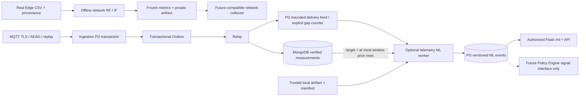

# Архитектура ML — этап 6

Два независимых эксперимента. Исходный iot-test.ipynb сохранён побайтно и не стал
production entrypoint. Network IDS не подписывается на MQTT и не получает
фиктивные сетевые признаки из temperature/humidity.

## Модули

- src/classifier/ml/schema.py, network.py, splitting.py, metrics.py: explicit
  network schema, train-only Pipeline/ColumnTransformer, grouped/time partitions,
  label-based metrics. inference.py — интерфейс будущего collector, не live IDS.
- telemetry_features.py: per-device/epoch causal windows, train-only robust
  baseline, statistical detector и IsolationForest.
- train.py: explicit-path train/evaluate, no dataset substitution; artifacts.py:
  private trusted root, manifest/hash/version checks и export pipeline целиком.
- src/ml_storage.py: SQLAlchemy Core feed/state/models/events. Не импортирует
  sklearn, поэтому базовый runtime работает без ML зависимостей.
- worker.py: отдельный процесс, не MQTT callback и не outbox relay/HTTP request.
- src/ml_signals.py: модельный сигнал, без выбора crypto profile/commands.

## База и подтверждение источника

Миграция0004 добавляет4 таблицы, всего23 включая legacy и alembic_version:
ml_observations, ml_feed_state, ml_models, ml_anomaly_events. Legacy/replay/outbox
не удаляются и их PK не меняются. Полные тесты проверяют переход со stage5 schema.

После Mongo write и его подтверждения relay в PG acknowledge transaction сохраняет
source identity в ml_observations. Самой модели/worker для этого не требуется.
Если PG acknowledge откатился, повтор Mongo idempotent insert и PG transaction
создадут один marker. Если feed заполнен, delivery всё равно подтверждается,
увеличивается overflow_skipped и last_gap_at. Это явный ограниченный режим,
**не** обещание полной обработки всех исторических Mongo документов.

## Разделение результатов

1. Crypto/protocol rejections — прежние ingestion metrics, не выводы ML.
2. Простые пороги temperature/humidity/delay — прежний Anomalies journal.
3. ML — отдельные versioned events, model-specific scores, DEMO/RESEARCH mode.

Ни один из них автоматически не выбирает Ascon/другой алгоритм. Minimum protection
остаётся текущей конфигурацией MQTT/TLS/AEAD. Policy Engine, commands, FastAPI,
«Магма»/CRISP не реализованы. Связь model↔crypto configuration не добавлялась.

## Ресурсы и область гарантии

Online worker: CPU1, memory768MiB, batch16 (1..128), один claim перед каждой
оценкой; target + максимум256 прошлых записей, один fitted artifact до64MiB.
Истории всех устройств в Python RAM не накапливаются. Mongo calls вне PG lease
transaction; лимиты driver/server ограничивают отдельные IO операции. Метрики:
per-event prepare_ms/inference_ms/delivery_ack_lag_seconds, статусные counts,
feed retained/published/overflow/pruned, model heartbeat/staleness.

Будущие100/1000/5000/10000 устройств не benchmarked. Текущие scalar Mongo/PG
round trips, глобальная admission lock этапа5 и feed-state row lock — известные
ограничения. Admission lock не оптимизировалась. Legacy shared PG runtime role,
Mongo standalone/внутрисетевая БД без TLS и Flask dev server остаются долгом.
