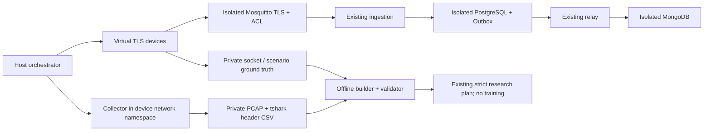

# Изолированный стенд MQTT/TLS — этап 7.5b

Стенд включается только дополнительным `compose.research.yaml` и профилем
`research`. Генератор, Mosquitto, PostgreSQL, MongoDB, receiver, relay и optional
Policy Worker принадлежат **отдельному** проекту `lcm-stage7b-*`. Рабочие services,
volumes, credentials и models не используются. Предпочтителен отдельный VM/host.
На общем хосте сеть Docker internal, публикация broker/web ports удалена,
контейнеры имеют CPU/RAM quotas и rotation logs. Не подключайте внешние networks.

Collector видит оригинальный путь publisher→broker, а не broker→receiver.
Он не расшифровывает TLS, не подключается к MQTT и не имеет credentials. Только
NET_RAW у tcpdump, без NET_ADMIN, host network и privileged. Генератор получает
только CA, индивидуальные passwords/Ascon keys выбранного лабораторного пула;
receiver/web/control/DB passwords туда не монтируются. Каждый клиент использует
TLS hostname validation, свой ACL topic, telemetry v2, Ascon-AEAD128 и постоянный
SQLite sequence counter. При перезапуске счётчики сохраняются в отдельном volume.

Генерация значений датчиков — имитация корректной нагрузки, не реальные физические
данные и не ground truth кибератак. Сеть/PCAP при этом реальные. IDS автоматически
не запускается, модели не обучаются/не устанавливаются, Policy остаётся DRY_RUN.

Запуск, лимиты и очистка — [DATASET_COLLECTION.md](DATASET_COLLECTION.md).
Разметка — [NETWORK_GROUND_TRUTH.md](NETWORK_GROUND_TRUTH.md).
