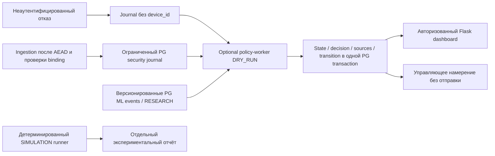

# Уточнение этапа 8 — Policy recommendation отдельно от live control

Policy Engine/worker остаются DRY_RUN. RESEARCH/DEMO trusted_detector=false и
CRITICAL/ALERT не дают права отправки команды. Registry поддерживает два проверенных
software AEAD, но это не hierarchy стойкости. Только отдельный admin+CSRF manual
control layer создаёт durable live intents. Его MQTT credentials/keys отсутствуют
у Policy/web. Старый control_contract.py/AckSimulator остаётся simulation.

policy_device_states.configured_profile/applied не заменяют live_control_devices
и live_control_evidence. Реальные verified/requested/reported поля — /control;
страница policy прямо разделяет эти источники. Подтверждение по telemetry не
выводится из рекомендации. Архитектура: ADAPTIVE_CRYPTO_ARCHITECTURE.md.
Ниже сохранено историческое описание этапа7; «нет live channel/только Ascon»
относилось к тому этапу, а не к opt-in manual layer этапа8.

# Policy Engine — этап 7

Policy Engine формирует решения в DRY_RUN. Он не обучает ML, не расшифровывает
MQTT, не пишет измерения в MongoDB и не отправляет управляющие команды.
Ascon-AEAD128 остаётся единственным реализованным криптографическим профилем.

Модули: signals — контракты и адаптер ML; engine — чистая FSM; rules —
декларативная конфигурация; profiles — capability registry; state/models — PG;
worker — polling/health/retention; simulation — синтетические сценарии;
control_contract — формальный контракт и отдельный симулятор ACK; web — Blueprint.
src/security_events.py хранит ограниченный журнал независимо от worker.

## Достоверность и источники

- accepted/replay: журнал создаётся после AEAD и сверки реестра устройства;
  replay означает повтор корректного пакета, в том числе штатный QoS1, а не
  доказанную атаку. При rollback ingestion откатываются и эти наблюдения.
- rejected: общий InvalidTelemetry; разделение AEAD/формат/неверная привязка
  существующим исключением не сохраняется. Device ID всегда NULL. Такие отказы сохраняются только как
  source audit, без самостоятельного решения и состояния устройства. Содержимое
  поддельного AAD не становится достоверной идентичностью. MQTT subscriber не
  получает username publisher; broker auth/ACL logs пока не подключены.
- physical_anomaly/delivery_delay: те же условия, что у старого Anomalies:
  temperature>60 или humidity>70, иначе delay>0.5s. Наличие правила не доказывает
  кибератаку. Старые записи Anomalies автоматически не backfilled: нет надёжной
  идентичности исходного измерения; новый журнал связан с device/epoch/sequence.
- ML: адаптер использует src/ml_signals.py, сверяет registry и полную семантику.
  DEMO/RESEARCH и trusted_detector=false сохраняются. Network collector отсутствует;
  live worker принимает только реально существующие PG events, не выдумывает их.
- system: устаревшая телеметрия/ML означает UNKNOWN, не атаку. Worker требует PG;
  при outage снимает readiness, не фиксирует локальные решения.

security_violation — предусмотренное достоверное условие правил, проверяемое
контролируемыми тестами/симуляцией. Реального online источника критических
security_violation в текущем receiver нет; новый источник потребует отдельного
проверенного адаптера. Внешнего API приёма произвольных trusted signals нет.

## PostgreSQL и конкуренция

0005_policy добавляет 10 таблиц. 0006_policy_control отдельно добавляет независимый
счётчик команд. Всего 34 таблицы с сохранением прежних 23, ML и replay-state.
Статические SQL snapshots миграций не зависят от будущих изменений ORM.

Версии immutable по config SHA-256. Активация сериализована advisory lock;
worker берёт shared lock активной версии на короткую transaction. Для устройства
INSERT ON CONFLICT и FOR UPDATE сериализуют состояние. UNIQUE(event_id, version)
защищает от повторных решений; сохранение signal/state/decision/transition/intent
атомарно. При смене версии сохраняется более осторожный guard, восстановление
требует новых положительных оснований. Никаких сетевых Mongo/MQTT/ML вызовов
в этой транзакции нет. [SQLAlchemy locking API](https://github.com/sqlalchemy/sqlalchemy/blob/rel_2_0_49/doc/build/core/selectable.rst).

Рабочие выборки ограничены: batch32 (1..128), evidence128, healthy evidence128,
watchdog128. Чтение источников через anti-join по уникальным ID, а не опасный
cursor только по timestamp или sequence DB commit. Каждая вторая итерация отдаёт
приоритет ML, если он ожидает обработки. Источники одного устройства упорядочены
по времени; поздние события аудируются без ретроспективного изменения состояния.

## Границы

Worker опционален. При выключенном worker MQTT/PG/Outbox/Mongo/ML работают;
журнал finite100000, при заполнении overflow растёт, новые наблюдения политики
пропускаются явно. Это потеря policy coverage, не потеря telemetry admission.
Полнота исторического анализа и exactly-once end-to-end не заявляются.
Shared PG runtime role, глобальные admission/capacity locks, внутренний DB TLS,
HA и большие нагрузки остаются ограничениями прежних этапов.
