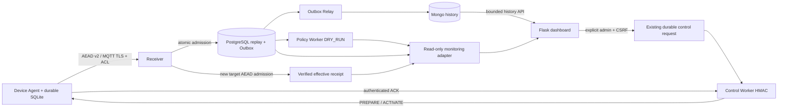

# Этап 9 — интеграция системы

Исходный baseline: d3cd219e39c719c6a53db057c58635f2b0410a8d.
Flask/Jinja/Bootstrap сохранены. Нет нового frontend framework или WebSocket server.
Новый dashboard использует ограниченный polling (3 s) вместо смешанного web MQTT
memory buffer. Старый Socket.IO сохраняет authentication/CSRF/same-origin checks.

## Authority и свежесть

| Значение | Источник | Семантика |
|---|---|---|
| inventory/enabled/epoch | telemetry_devices | provisioning, не presence |
| latest telemetry | telemetry_outbox current device/epoch | PG-committed admission; age ≤15 s = recent |
| история/графики | /api/telemetry/history, Mongo measurements | device filter, 50 rows, UTC query / local display |
| verified effective | live_control_devices + matching immutable live_control_evidence | device/epoch/profile/event binding; reported не заменяет receipt |
| requested/phase | live_control_transitions | expired помечается uncertainty, read adapter не переписывает FSM |
| device reported/ACK | live_control_devices.reported_profile, live_control_acks allowlist | сообщение устройства, не AEAD confirmation |
| command timeline | commands/audit/ACK/transitions | delivery, ACK и telemetry разделены, body/wire не выдаются |
| risk/recommendation | active-version policy_device_states/decisions/signals | DRY_RUN; state/worker age >30 s явно stale |
| security facts | security_observations | replay/physical/delay — наблюдения; anonymous rejected отдельно |
| receiver | component_heartbeats | SUBACK + connected diagnostic, TTL 10 s; не physical presence |
| control/policy workers | existing PG heartbeats | TTL 10/30 s; не Docker running |
| Mongo available | отдельное bounded authenticated read | отказ Mongo не скрывает PG/receiver facts |
| backlog | PG outbox status counts | pending не считается потерей до дренирования |
| ML | explicit demo config + bounded ml_models/results | disabled/unknown/unavailable/research; trusted_detector=false |

## Read model

`src/web/monitoring.py`: только SELECT, REPEATABLE READ/READ ONLY PG snapshot,
statement timeout 2 s, inventory 1–100 rows/offset≤10000, детали только по identity,
fixed bounded histories. Bulk queries, без SQL-запроса на каждую строку device loop.
PG connect timeout 2 s, pool wait 3 s; Mongo read ограничен existing repository
connection/socket/operation timeout и max_time_ms. При PG failure 503 (либо safe
500 из auth user loader при недоступной PG) браузер инвалидирует current snapshot.
Mongo probe независим; history 503 отображается как недоступность, не пустая история.

Не создаётся новая копия effective в красивой таблице. Единственная новая таблица
`component_heartbeats` (аддитивная миграция 0009) — диагностическая; никто не
использует её для admission/nonce/control authorization. Receiver reporter работает
в отдельном потоке, SQL error не подтверждает MQTT message и не меняет commit path.

## Routes

`/` и `/monitoring` — сводка; `/devices/<device>` — карточка. `/control` использует
тот же список проверенных устройств. Два read shapes нового `/api/monitoring`
(сводка) и `/api/monitoring/<device>` (bounded detail) нужны для согласования inventory,
security и receipt без выдачи сырых control bodies. Все требуют sensor_data access.
Повторно используются `/api/telemetry/history` и защищённые switch/reconcile APIs.
`/policy`, `/ml`, `/telemetry` сохранены как расширенные диагностические страницы.
Legacy `/api/latest-data`/dashboard assets не являются authority нового интерфейса.

## Протоколы и trust

Ни одной отправки MQTT из Flask handler. Только durable request → control worker.
Policy→Control auto bridge отсутствует. Risk не выбирает AES автоматически; профили
не ранжируются по условной силе. HMAC/ACK/TTL/command replay/nonce reservations/
AEAD/replay/Outbox/effective semantics сохранены. UI не выдаёт 202 или ACK за успех.
Все данные DOM через textContent/DOM API, native canvas charts, bounded tables.
Источники решений раскрываются по требованию; основной UI не представляет SQL/JSON dump.
